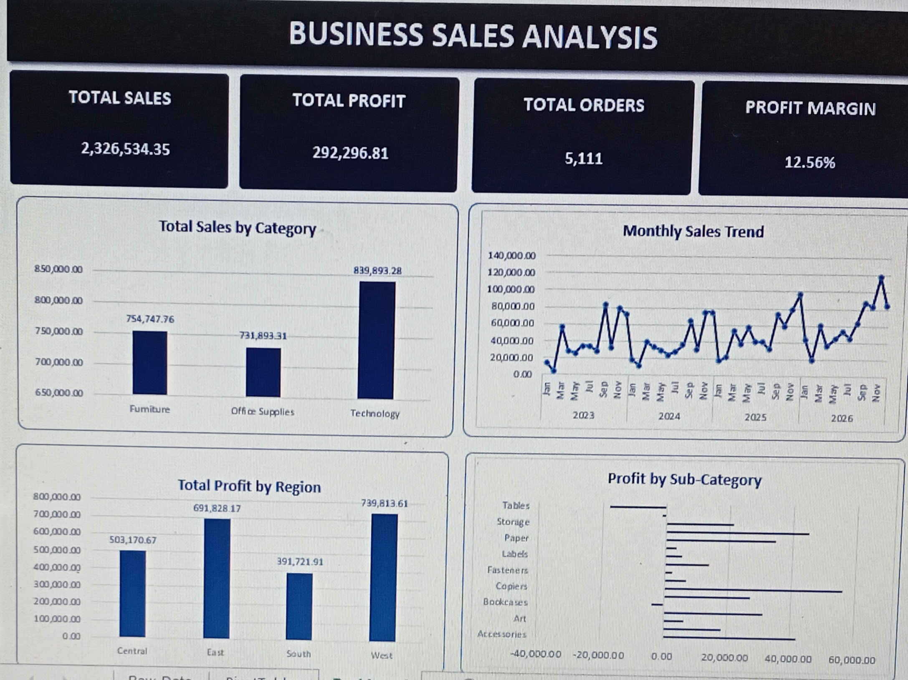

# Business Sales Analysis

## Project Overview

This project analyses business sales data to evaluate sales performance, profitability, regional differences, product performance, and trends over time.

The goal is to turn raw sales data into useful business insights using Python, SQL, and Microsoft Excel.

## Dashboard Preview

## Tools Used

- **Python:** Data inspection, analysis, calculations, and visualisation using pandas and Matplotlib.
- **SQL (SQLite):** Querying sales data, aggregating results, and investigating business performance.
- **Microsoft Excel:** KPI calculations, PivotTables, charts, and an interactive-style dashboard.

## Business Questions

1. What are the total sales, total profit, and number of unique orders?
2. Which product categories generate the most sales and profit?
3. Which regions perform best and worst in terms of profitability?
4. Which sub-categories and products generate losses?
5. How are sales and profit distributed across discount levels?
6. How do sales and profit change over time?

## Key Findings

- **Total sales:** 2,326,534.35
- **Total profit:** 292,296.81
- **Unique orders:** 5,111
- **Overall profit margin:** 12.56%

### Category Performance

Technology generated 146,543.38 in profit, followed by Office Supplies at 126,023.44. Furniture generated only 19,730.00 in profit despite recording 754,747.76 in sales.

Furniture also had the lowest category profit margin at approximately 2.61%, making it an important area for further investigation.

### Regional Performance

The West region recorded the highest total profit at 110,798.82 and the highest regional profit margin at approximately 14.98%.

The Central region had the lowest regional profit margin at approximately 7.92%, suggesting a need to investigate its product mix, pricing, discounts, and operating performance.

### Product Performance

Tables recorded the largest total loss among the sub-categories analysed, at approximately 17,753.21.

The results highlight the importance of examining profitability rather than relying on sales revenue alone.

### Discount Analysis

Higher discount levels were associated with weaker average profitability in the analysed data. This relationship warrants further investigation, but it does not by itself establish that discounts caused the losses.

### Sales Trends

The dataset contains records through 2026. Because 2026 is incomplete, its total should not be compared with previous full years as though all periods cover the same length of time.

## Project Workflow

1. Inspected the sales dataset using Python.
2. Analysed business performance using Python.
3. Wrote SQL queries to investigate sales, profitability, regions, products, discounts, and time trends.
4. Created charts to communicate the findings.
5. Built an Excel dashboard containing KPI figures and four charts.

## Deliverables

- Python analysis scripts
- SQL analysis queries
- Python-generated charts
- Excel sales analysis dashboard

## Dataset Source

This project uses the Sample Superstore dataset for sales and profitability analysis.

The dataset was obtained from Tableau's official sample data resources:

[Tableau Sample Data](https://public.tableau.com/app/learn/sample-data?qt-overview_resources=1)

To reproduce this project, obtain the dataset from the source, place the CSV file in the `data/` folder, and ensure its filename matches the one referenced in the Python scripts.

**Note:** The dataset's currency and redistribution terms have not been independently verified. The original dataset is therefore not included in this public repository.

## Conclusion

The analysis shows that strong sales do not always translate into strong profitability. Furniture and the Tables sub-category deserve further investigation, while the West region provides a useful benchmark for regional performance.

The project demonstrates how Python, SQL, and Excel can be combined to analyse data and communicate findings that support business decision-making.

## Limitations

The findings describe the available dataset and should not automatically be generalised to other businesses or periods. Further analysis would be required to establish the reasons behind observed differences in profitability.
